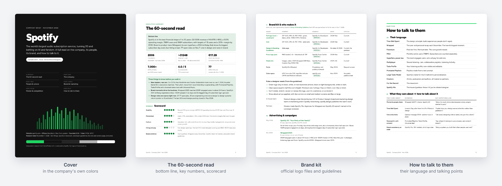
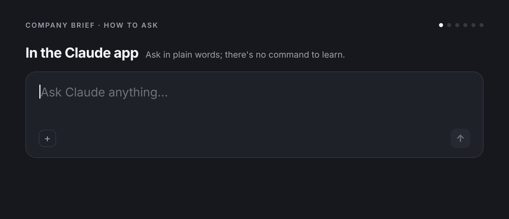
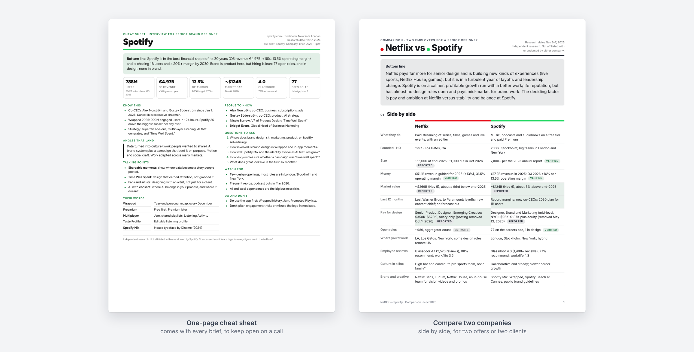

# Company Brief

A Claude skill for job seekers, designers, marketers, and anyone getting ready to talk to or work with a company. Name a company and Claude researches it, then hands back a designed PDF brief in the company's own colors, a one-page cheat sheet, and links to its official logos and brand guidelines.



**See real examples:** [Spotify brief (15 pages)](examples/Spotify-Company-Brief-2026-11.pdf) · [Spotify cheat sheet](examples/Spotify-Cheat-Sheet-2026-11.pdf) · [Netflix vs Spotify comparison](examples/Netflix-vs-Spotify-2026-11.pdf)

## Get started in 3 steps

1. **Download** [company-brief.zip](company-brief.zip) (open it, then click the download button). Don't unzip it.
2. **Add it to Claude.** In Claude on the web or desktop, turn on Settings > Capabilities > "Code execution and file creation". Then go to Customize > Skills, click **+**, then **Create skill > Upload a skill**, and pick the zip.
3. **Ask for a brief.** Start a new chat and type: *"Make me a company brief on Figma."*

That's it. Claude finds the skill on its own, and you don't need any special commands.

> GitHub's green "Code > Download ZIP" button won't work here, because it wraps the files in an extra folder. Use `company-brief.zip`.

## How to use it



### In the Claude app

There's no command to type. Start a new chat and describe what you want in your own words, and Claude matches your request to the skill. Requests like these all work:

- "company brief on…", "deep dive on…", "research … before my interview"
- "should I take the offer from…", "is … a good place to work?"
- "compare … and …", "help me choose between these two offers"
- "brand kit for…", "we just signed … as a client"

If Claude ever answers without making a PDF, start your message with **"Use the company-brief skill:"** and it will.

### In Claude Code

Type the slash command, then the company. Add any options after it, in any order:

```
/company-brief figma.com
/company-brief Figma for Senior Brand Designer
/company-brief Oatly brand kit
/company-brief notion.so shareable
/company-brief compare Figma and Canva
/company-brief refresh Figma
```

Plain-words requests work in Claude Code too.

### Example requests

| Your situation | Try asking | You get |
|---|---|---|
| **Starting a job search** | "Make me a company brief on Figma." | A full brief and a one-page cheat sheet |
| **Interview coming up** | "Research Linear before my interview for Senior Brand Designer. Here's my resume." | The same, with hiring, people, likely questions, and your angle for that role |
| **Weighing an offer** | "I have an offer from Ramp for Design Lead. Should I take it?" | The brief, plus a "Before you sign" page on equity, leveling and what to ask |
| **Choosing between two** | "Help me choose between my offers from Netflix and Spotify." | A side-by-side comparison and a cheat sheet for each company |
| **New client or brand project** | "We just signed Oatly as a client. Include a brand kit." | Official logo files, brand guidelines, fonts and colors, plus kickoff prep and what to ask the client for |
| **Pitching a company** | "I'm pitching Patagonia on an experiential campaign. Brief me." | Their priorities, recent campaigns and events, their language, and talking points |
| **Sending it to someone else** | Add "shareable" to any request | A version with nothing personal in it |
| **A few weeks later** | "Refresh my Figma brief." | An updated brief with a "What's changed" page (attach the old PDF if it's from another chat) |

You can combine these: *"Compare Figma and Canva for a Senior Brand Designer role, shareable."*

### Tips for a better brief

- **Give a URL** when the name is common ("linear.app" rather than "Linear") so Claude researches the right company.
- **Attach your resume or portfolio link.** The "your angle" section and the 30-second pitch get specific to you.
- **Mention the role, and any offer or recruiter** you're talking to. Hiring, people and interview prep focus on that.
- **Let it take its time.** A full brief reads dozens of sources, including the company's own site and careers page, and finishes with the PDF and cheat sheet in the chat. A comparison is quicker.

### After the brief: follow-ups to try

- "Write me a cover letter using the brief."
- "Give me 10 mock interview questions and grade my answers."
- "Turn the talking points into a 30-second intro I can say out loud."
- "Draft a short note to their Head of Design."
- "Make a shareable version for my friend who's applying there."

## What you get



| Part | What it covers |
|---|---|
| **The 60-second read** | Bottom line, key numbers, three things to know, and a scorecard |
| **The company** | What they do, how they make money, mission, history, financials |
| **People & culture** | Leaders to know, open roles and pay from real postings, employee reviews, culture |
| **Brand & marketing** | Colors and fonts from the live site, voice, a **brand kit** of official logo files and guidelines, campaigns, events, social, recent news |
| **Market & competition** | Market, competitors, partners, risks |
| **How to talk to them** | Their language, talking points, your angle, interview or kickoff prep, questions to ask, do's and don'ts |

Every number has a source, a date, and a confidence tag (Verified, Reported, Company claim, Estimate, or Unknown), and the brief says plainly when something couldn't be found.

## What's new

- **Nov 9, 2026:** A how-to-use section with an animated demo, example requests by situation, and follow-ups to try.
- **Nov 7, 2026:** Every brief now comes with a one-page cheat sheet. New: compare two companies, refresh an older brief, sample PDFs and previews.
- **Nov 6, 2026:** Brand kit with links to official vector logos, current brand guidelines, fonts and color specs, plus a brand-work mode for designers and agencies.

**Already installed?** In Claude, go to Customize > Skills, delete the old Company Brief, then upload the new [company-brief.zip](company-brief.zip).

## Install in Claude Code

```bash
git clone https://github.com/BeautifulEngine/company-brief.git
mkdir -p ~/.claude/skills && cp -r company-brief/company-brief ~/.claude/skills/
```

Then start `claude` in any folder and type `/company-brief linear.app`, or ask in plain words.

## Ground rules the skill follows

- Public information only. People are covered by title and public work, with no photos, personal contact details, or private life.
- Logos, fonts and brand images are linked, never copied. The brief prefers the brand's own press kit, brand portal or guidelines, labels third-party sources, opens every link to check the file format, and checks that the logo matches the live site. The files belong to the brand, and its usage terms apply.
- Review quotes are short and attributed; articles are summarized, not pasted.
- Every brief is labeled as independent research, not affiliated with the company, and not legal or financial advice.

Facts come from public sources and can be out of date or wrong. Check anything you plan to rely on, especially pay, funding, and headcount.

## How it works

```
company-brief/
├── SKILL.md                     the workflow Claude follows
├── assets/
│   ├── brief.css                the PDF's base stylesheet
│   ├── brief-template.html      skeleton of every section
│   ├── cheatsheet-template.html the one-page cheat sheet
│   └── compare-template.html    the side-by-side comparison
├── scripts/
│   ├── fonts.py                 installs free fonts (Fontsource) for the brand's type
│   ├── tokens.py                turns brand colors into a readable color system
│   ├── render.cjs / render.py   renders the PDF and checks fonts, contrast, and blanks
│   ├── audit.js                 the check both renderers run
│   └── contact_sheet.py         a one-image preview of every page
└── references/
    ├── research-playbook.md     where to look for each section
    ├── brand-extraction.md      colors and type from the live site, and the brand kit
    └── components.md            layout pieces and writing rules
```

Rendering tries Node Playwright, then Python Playwright, then a Chrome install, then WeasyPrint, so it works in most setups. Brand colors are darkened where needed so text stays readable.

## Updating the zip

If you change files in `company-brief/`, rebuild the upload file from the repo root:

```bash
rm -f company-brief.zip && zip -r company-brief.zip company-brief -x '*__pycache__*' '*.DS_Store'
```

## License

MIT. See [LICENSE](LICENSE). The example briefs are independent research about public companies and aren't affiliated with or endorsed by them.
